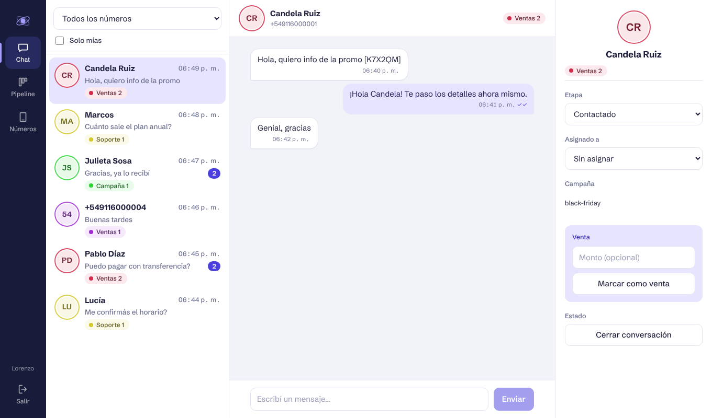
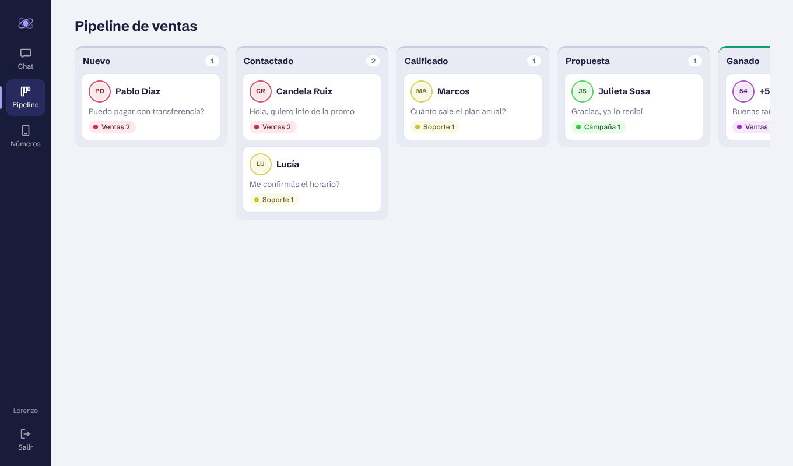
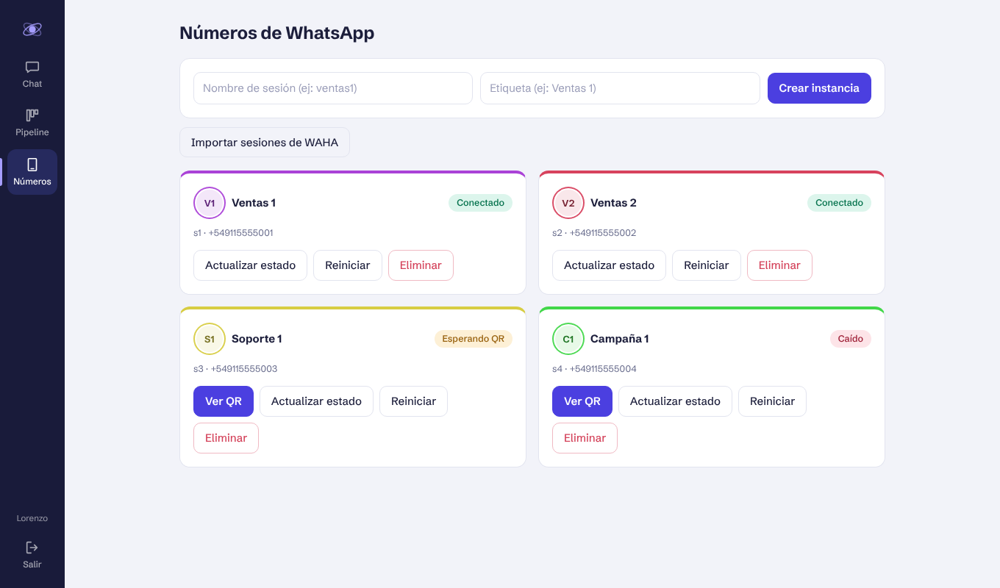
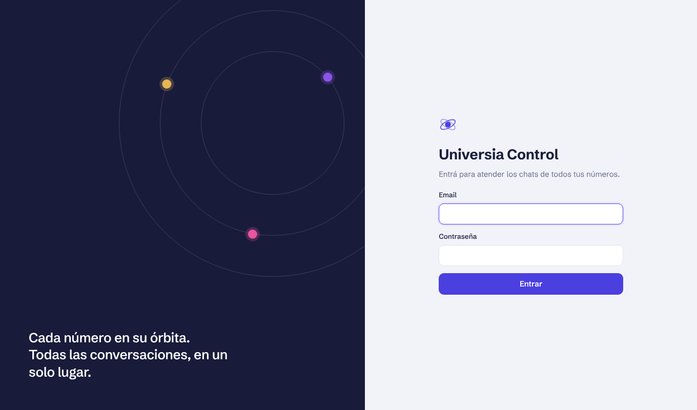
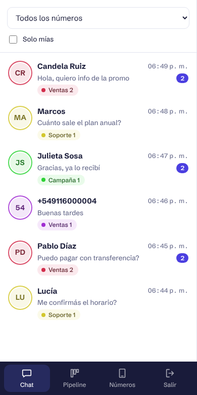
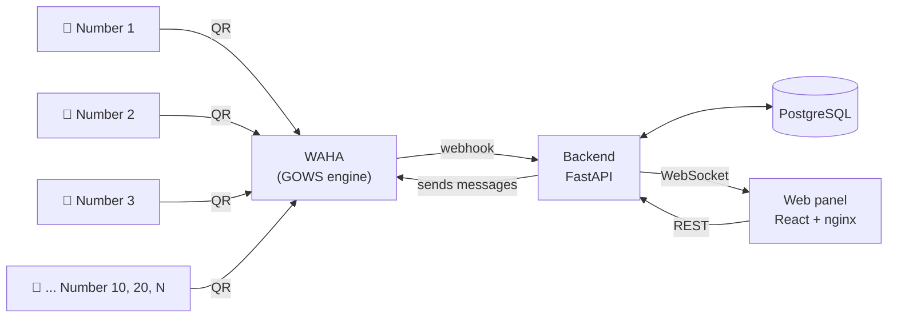
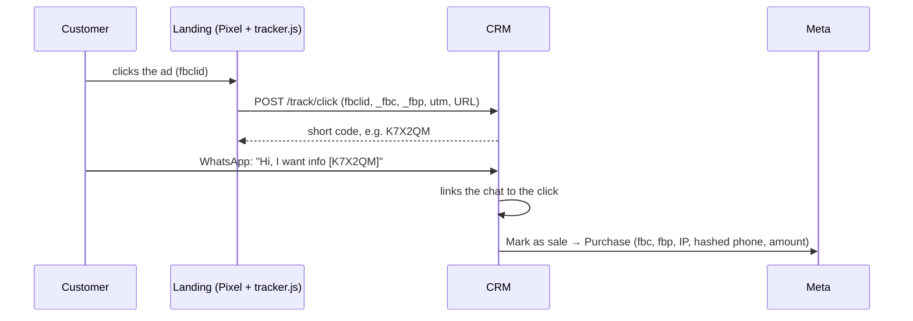

<div align="center">

# 🟢 Universia Control

**All your WhatsApp numbers in a single inbox.**
Self-hosted CRM with an operator team, a sales pipeline and real-time messages.


</div>

> ⚠️ Project under development, not affiliated with WhatsApp or Meta. It connects by QR code through [WAHA](https://waha.devlike.pro), an **unofficial** route: read [Known limitations](#known-limitations) before using it with important numbers.

## What it looks like

<p align="center">
  
</p>

Each number has its own color, repeated on the avatar, the label and the pipeline, so you can see at a glance which number each customer wrote to.

<table>
  <tr>
    <td width="50%"><br><sub>Sales pipeline</sub></td>
    <td width="50%"><br><sub>Number management</sub></td>
  </tr>
  <tr>
    <td width="50%"><br><sub>Login</sub></td>
    <td width="50%" align="center"><br><sub>On mobile</sub></td>
  </tr>
</table>

> Screenshots use sample data.

## What is it?

If you serve customers on WhatsApp with several phones, you end up jumping from phone to phone. **Universia Control** connects all those numbers to a single web panel where your team sees, answers and organizes every conversation, with the data on **your own server**.

## Features

| | Feature | Details |
|---|---|---|
| 💬 | **Unified chat** | Conversations from all numbers together; filter by number and "mine only"; reply from the panel; sent / delivered / read ticks |
| ⚡ | **Real time** | Messages appear instantly (WebSocket with automatic reconnection) |
| 📱 | **Number management** | Create instances, scan the QR from the panel, see the status (connected / waiting for QR / down), restart and delete. Only imports sessions that already exist in WAHA |
| 🧩 | **Embedded WAHA** | A *WAHA* tab inside the panel: the WAHA dashboard (sessions, QR, API, logs) is shown in the same system, without leaving the CRM |
| 🧲 | **Sales pipeline** | Kanban board (*Nuevo → Contactado → Calificado → Propuesta → Ganado / Perdido*); drag and drop to move cards |
| 👥 | **Team** | JWT login, administrator / operator roles and conversation assignment |
| 📊 | **Data for reports and Meta Ads** | Stores the time of the first message and the first reply, the `ctwa_clid` from Click-to-WhatsApp ads (when it arrives) and each session's status history |
| 🩺 | **Diagnostics** | `GET /webhooks/recent` shows the latest webhooks received and processing errors |

## How it works



**No limit on numbers:** connect as many as your server can handle (each WAHA session uses memory). Example with 10 numbers:

| Session | Label | Use |
|---|---|---|
| `ventas1` – `ventas4` | Ventas 1 to 4 | Sales |
| `soporte1` – `soporte3` | Soporte 1 to 3 | After-sales and complaints |
| `campana1` – `campana3` | Campaña 1 to 3 | Click-to-WhatsApp ads |

They all show up together in Chat; filter by number from the panel.

**Incoming message:** the customer writes → WAHA receives it → calls the backend webhook → it is stored in Postgres → the backend emits it over WebSocket → it appears in every operator's panel.

**Outgoing message:** the operator types in the panel → the backend sends it through WAHA → it is stored and emitted → WAHA confirms delivery and the ticks update.

The backend does not talk to WhatsApp directly but through a **provider layer** (`backend/app/services/providers.py`). Today the only provider is WAHA; the plan is to add Meta's official Cloud API for critical numbers without touching the rest.

| Service | Technology | Port |
|---|---|---|
| `frontend` | React + Vite + TypeScript, served by nginx | 5173 |
| `backend` | FastAPI + SQLAlchemy | 8000 |
| `waha` | WAHA (WhatsApp HTTP API), GOWS engine | 3000 (local only) |
| `waha-embed` | nginx that lets the WAHA dashboard be embedded in the *WAHA* tab | 3001 (local only) |
| `postgres` | PostgreSQL 16 | internal |

## Getting started

**Requirements:** Docker with Docker Compose, and a phone with WhatsApp for each number you want to link.

```bash
git clone https://github.com/lorenzo00005/universia-control.git
cd universia-control
cp .env.example .env        # change ALL the "cambiar-esto" values
docker compose up -d --build
```

| URL | What it is |
|---|---|
| http://localhost:5173 | **Panel** (user and password: `ADMIN_EMAIL` / `ADMIN_PASSWORD` from `.env`) |
| http://localhost:8000/docs | Interactive API documentation |
| http://localhost:5173 → **WAHA** tab | WAHA dashboard inside the panel (served from `localhost:3001`) |
| http://localhost:3000/dashboard | WAHA dashboard directly (optional) |

> The administrator is created automatically the first time the database starts. If you change `ADMIN_EMAIL` or `ADMIN_PASSWORD` afterwards, you have to delete the data: `docker compose down -v`.

**WAHA dashboard:** from the panel's *WAHA* tab (or directly) log in with `WAHA_DASHBOARD_USERNAME` / `WAHA_DASHBOARD_PASSWORD`. The first time you open it, in the *Workers* panel click the pencil and paste `WAHA_API_KEY` from `.env` so it can manage the sessions.

### Environment variables

| Variable | Purpose |
|---|---|
| `POSTGRES_USER` · `POSTGRES_PASSWORD` · `POSTGRES_DB` | Database |
| `WAHA_API_KEY` | WAHA API key |
| `WAHA_DASHBOARD_USERNAME` · `WAHA_DASHBOARD_PASSWORD` | WAHA dashboard access |
| `WEBHOOK_SECRET` | Secret in the webhook URL that WAHA calls |
| `JWT_SECRET` | Signing key for session tokens |
| `ADMIN_EMAIL` · `ADMIN_PASSWORD` | First administrator user |
| `CORS_ORIGINS` | Allowed origins (frontend development only) |

## Connecting your first number

1. Open the **Números** tab → type a session name (e.g. `ventas1`) and a label → **Crear instancia**.
2. On the phone: WhatsApp → *Linked devices* → *Link a device* → scan the QR.
3. The status switches to **Connected** by itself. Send a message to that number from another phone and it shows up in **Chat**.
4. Repeat steps 1–3 for each extra number (`ventas2`, `ventas3`, … `ventas10`): there is no limit in the software.

WAHA notifies the backend of every session through a global webhook (`WHATSAPP_HOOK_URL` in `docker-compose.yml`), so sessions created from the WAHA dashboard work too. Only **new** messages are captured: history is not imported.

## Publishing it on the internet (one domain, CRM + WAHA)

With `docker-compose.prod.yml` everything sits behind **Caddy** with automatic HTTPS (Let's Encrypt):

| URL | What it is |
|---|---|
| `https://crm.yourdomain.com` | CRM panel |
| `https://waha.yourdomain.com` | WAHA dashboard (with an extra Caddy user/password on top of the WAHA login). It also appears inside the panel, in the *WAHA* tab |

1. Create two **A** DNS records (`crm` and `waha`) pointing to the server's IP.
2. On the server, fill in `.env` with your own keys and the production variables (`CRM_DOMAIN`, `WAHA_DOMAIN`, `WAHA_BASIC_HASH`).
3. Open only ports **80 and 443** (and SSH) in the firewall.
4. Start it:

```bash
docker compose -f docker-compose.yml -f docker-compose.prod.yml up -d --build
```

In production, Postgres, the backend, WAHA and the frontend **do not publish ports**: everything goes through Caddy. The panel's WebSockets work over `wss://` with no extra configuration.

## Carrying it on a USB drive

There are two modes. In both, the public link comes from a Cloudflare tunnel with no domain (`docker-compose.usb.yml`).

### Windows mode: runs in the background while you use the PC

The external drive stays plugged into a Windows PC with **Docker Desktop**. Everything starts by itself at sign-in, with no windows, and you can keep using Windows normally.

1. Copy the project folder to the drive, at `E:\universia-control` (the letter can be different; the scripts find it on their own).
2. One time only, double-click `windows\instalar-autoarranque.bat`.
3. Done: at every Windows sign-in with the drive connected, the system opens Docker Desktop if needed, starts the CRM and saves the link in `URL-ACTUAL.txt` (`windows\ver-link.bat` shows it).

| Script | What it does |
|---|---|
| `windows\instalar-autoarranque.bat` | Creates the task that starts everything at sign-in |
| `windows\desactivar-autoarranque.bat` | Removes it |
| `windows\iniciar-ahora.bat` | Starts without rebooting |
| `windows\ver-link.bat` | Shows the current public link |
| `windows\parar.bat` | Stops the services (data is not deleted) |
| `windows\migrar-datos.bat` | One time: stops everything and copies the WhatsApp sessions from an old folder (by default `D:\universia-control`) to this drive, then starts from here |

- **WhatsApp sessions:** they live in `data\waha` on the drive.
- **Database:** Postgres uses an internal Docker volume (on the PC's disk, because Postgres does not work well on a mounted NTFS/exFAT drive). A backup is saved every 6 hours to `backups\` on the drive (the last 14 are kept). If you plug the drive into **another PC** (without the database), it restores itself from the latest backup on startup.
- **If you unplug the drive:** the services stop by themselves. When you plug it back in, they start again (it checks every 30 seconds).
- **Resource use:** Docker Desktop reserves PC memory (several GB). If the PC is tight on RAM, limit WSL2 in `%UserProfile%\.wslconfig`.
- The log is in `iniciar.log`, inside the project folder.

### Linux mode: the drive boots its own system

An **external USB 3 SSD** with its own Linux. Plug it into any PC, boot that PC from the USB and the CRM comes up with a public Cloudflare link (no domain, no open ports, without touching that PC's Windows).

> Use an SSD, not a flash drive: Postgres writes constantly and flash drives wear out and slow down.

**Preparing the USB (one time)**

1. Install **Ubuntu Server 24.04** on the external SSD (from another installation USB). Enable **disk encryption (LUKS)**: if you lose the USB, nobody can access your WhatsApp sessions or your customers' data. It asks for the passphrase at boot.
2. Install Docker: `curl -fsSL https://get.docker.com | sh`
3. Clone the project into `/opt`:
   ```bash
   sudo git clone https://github.com/lorenzo00005/universia-control.git /opt/universia-control
   cd /opt/universia-control && sudo cp .env.example .env && sudo nano .env   # your own keys
   ```
4. Enable automatic startup:
   ```bash
   sudo cp usb/universia.service /etc/systemd/system/
   sudo systemctl enable --now universia
   ```

**Using it on any PC:** plug in the SSD, open that PC's boot menu (F12, F2, Esc or Del depending on the brand), choose the USB and type the encryption passphrase. Wait 1–2 minutes: the link appears on the login screen (`Universia Control -> https://....trycloudflare.com`) and is saved in `/opt/universia-control/URL-ACTUAL.txt`. That is the link operators use from outside. To see the link from another PC connected to that machine: `cat /opt/universia-control/URL-ACTUAL.txt`.

**About the link (temporary tunnel):**
- It is **random** and stays the same **as long as the tunnel keeps running**. It changes if you power off or reboot the PC, or if the `cloudflared` container restarts. Each time you start up, you have to give the new link to the team.
- Cloudflare offers it with no availability guarantee (it is meant for testing). For stable use, a domain and a named tunnel (fixed link) are better.
- Anyone with the link sees the login screen: use long passwords.
- The panel's **WAHA** tab only works from the machine itself; external operators use Chat, Pipeline and Números (the QR is scanned from *Números*).

**Careful with WhatsApp:** every time you connect from a different network, the number logs in from another IP and location, which can trigger alerts. Always use it from 1 or 2 places. With the USB unplugged, no messages come in and WAHA does not import history.

## Meta Pixel connection (sale → Purchase)

Designed for the **ad → landing → WhatsApp** flow. When you mark a chat as a sale, the CRM sends a `Purchase` event to Meta's **Conversions API**, attributed to the ad.



**Setup**

1. In Meta's Events Manager: copy the **Pixel ID** and generate a Conversions API **token**. Put them in `.env` (`META_PIXEL_ID`, `META_ACCESS_TOKEN`) and add your landing's domain to `LANDING_ORIGINS`.
2. In your landing page, after the Pixel code, paste the script (see [`landing/ejemplo.html`](landing/ejemplo.html)):

```html
<script src="tracker.js" data-crm="https://crm.yourdomain.com"></script>
<a href="#" data-wa-number="5491100000000" data-wa-text="Hi, I want information">Write to us</a>
```

3. To test without affecting campaigns, set `META_TEST_EVENT_CODE` (Meta's *Test events* section) and check that events show up there.
4. In the chat, right-hand panel: **Marcar como venta** (with an optional amount). The chat moves to *Ganado* and the event is sent in the background. You can see the status of each delivery at `GET /conversions` and retry failed ones with `POST /conversions/{id}/retry`.

**What is sent:** the click's `fbc` and `fbp`, the click's IP and browser, the landing URL, the phone number normalized and hashed with SHA-256 (never in clear), the amount and an `event_id`.

**Limits to keep in mind**
- If the customer deletes the `[XXXXXX]` code from the message, that chat has no ad attribution (the event is still sent with the hashed phone, with a worse match).
- Contacts that WhatsApp delivers as `@lid` carry no phone number: the event goes out without `ph`.
- If the code arrives in the first message but the customer writes from a different number than the one used on the landing page, attribution still works because it is based on the code, not the phone.
- Meta attributes within its own window (up to 7 days from the click, depending on your account settings).

## API

Full documentation at `/docs`. The main endpoints:

| Endpoint | Purpose |
|---|---|
| `POST /auth/login` · `GET /auth/me` | Authentication |
| `POST /track/click` (public) · `POST /conversations/{id}/sale` · `GET /conversions` · `POST /conversions/{id}/retry` | Click tracking and sending sales to Meta |
| `GET/POST /numbers` · `POST /numbers/sync` · `GET /numbers/{id}/qr` · `/status` · `POST /numbers/{id}/restart` · `DELETE /numbers/{id}` | WhatsApp numbers |
| `GET /conversations` · `GET/POST /conversations/{id}/messages` · `PATCH /conversations/{id}` · `POST /conversations/{id}/read` | Inbox |
| `GET/POST /stages` | Pipeline stages |
| `GET /users` | Operators |
| `POST /webhooks/waha/{secret}` · `GET /webhooks/recent` | WAHA event intake and diagnostics |
| `WS /ws?token=` | Real-time events |

## Project structure

```
├── docker-compose.yml        # postgres + waha + backend + frontend
├── .env.example              # configuration template
├── backend/
│   ├── app/
│   │   ├── routers/          # one file per resource
│   │   ├── services/         # messaging provider, webhook intake, real-time hub
│   │   └── models.py · schemas.py · security.py · deps.py · main.py
│   └── tests/                # pytest
└── frontend/
    └── src/
        ├── pages/            # Chat, Pipeline, Numbers, Login
        └── hooks/            # useRealtime (WebSocket with reconnection)
```

## Development

```bash
# Backend (tests use in-memory SQLite)
cd backend
pip install -r requirements.txt
python -m pytest -q

# Frontend (proxies to the backend on :8000)
cd frontend
npm install
npm run dev          # http://localhost:5173
npm test             # chat tests (vitest)
npm run build
```

## FAQ

**Why WAHA and not the official WhatsApp API?**
WAHA lets you use the phones you already have, with no Meta approval and no per-conversation cost. The downside: it is an unofficial connection, with the risks listed below.

**Can my number get blocked?**
Yes, it is possible with any unofficial tool. It depends more on the number and how it is used (new number, messages to strangers, volume, datacenter IP) than on the software. For critical numbers, the official Cloud API is a better fit.

**Do I lose my data if I restart?**
No: the database lives in a Docker volume and the WhatsApp sessions in `data/waha/sessions`. `docker compose down -v` does delete the database.

## Known limitations

- **Unofficial route:** sessions can drop and numbers can be blocked by WhatsApp. Read the [guide to protecting your numbers](#how-to-protect-your-numbers-anti-ban-guide).
- Tables are created with `create_all`; migrating to **Alembic** is still needed before production.
- Real time uses an in-memory hub; with more than one worker it has to move to Redis pub/sub.
- **Media files** are not yet sent or shown; groups and statuses are ignored.
- Pin the WAHA image version (`devlikeapro/waha:latest` in the compose file) before production.

### How to protect your numbers (anti-ban guide)

WAHA connects by QR as a linked device, something WhatsApp does not officially allow: its [messaging guidelines](https://www.whatsapp.com/legal/messaging-guidelines) prohibit unofficial clients, bulk sending and automation. **No practice guarantees 0% risk**; the goal is to look like a real person serving customers and to keep reports at zero. Meta does not publish the exact thresholds: the figures below are references from WAHA's documentation and from providers in the field (Green API, Whapi, Z-API, Periskope), not official rules.

#### 1. The rule that matters most: let the customer write first

WAHA's own guide puts it first: the bot should not start conversations, only reply. This CRM is designed for that (ad → landing → the customer taps the WhatsApp button and writes to you). Starting chats with strangers causes the most blocks, because every "Block and report" lowers the number's trust. A handful of reports in a row is enough to get it restricted.

#### 2. Before connecting a number

- Use **warm numbers**: with real usage history (months of chats, contacts who have it saved), not a freshly bought SIM.
- If the number is new, **do not scan the QR on the day of registration**: wait at least a day and use it like a person first (chats with acquaintances, photos, voice notes, a small group).
- Never connect a SIM that **has never received a WhatsApp message**: a number with no history that suddenly sends messages is the typical spam-farm profile.
- Complete the profile: **photo, name and status**.
- Keep **opening the app on the phone** from time to time and replying to something by hand. A number used only for automation looks more suspicious.
- Ask customers to **save your number** in their contacts: it greatly reduces "unknown sender" reports.
- Keep a number from **your own country** and, if you can, a server with an IP from the same or a nearby country; mismatches (an Argentine number always connected from another continent) add negative signals.

#### 3. Warm-up and pace

A common reference from providers for a new number (adapt it, do not take it as a rule):

| When | What to do |
|---|---|
| Day 1 | Manual chats with 3–6 contacts who reply. Text, maybe an image or sticker. No automation. |
| Day 2 | Go up to 10–15 conversations. Varied messages, ~1 per minute at most. |
| Days 3–6 | Add contacts and messages gradually; join 1–2 small groups (3–5 people). |
| Day 7 onward | Between ~12 and ~100 messages per day, depending on replies. After day 10 the number is much more resilient. |
| Following weeks | Scale **weekly**, not daily. Increase 10–20% at a time, never jump from 50 to 5,000. |

Prudent limits that repeat across guides: a new number should not exceed about **50 messages per day**, or ~30 per hour, and it helps to keep **at least 3 out of every 10 messages sent receiving a reply**. A number with 10 days of warm-up only handles a couple of dozen **new** conversations per day. Since in this CRM most messages are replies to customers who wrote first, those limits are rarely approached; they do matter if you will write to contacts first.

#### 4. How to reply without looking like a bot

These are the recommendations from WAHA's official guide for the reply flow:

1. **Mark as read** before answering (`POST /api/sendSeen`).
2. **Show "typing…"** (`startTyping`), wait a random time proportional to the message length and **only then send** (`stopTyping` + `sendText`).
3. **Avoid fixed timings**: send, wait a random 30 to 60 seconds and only then send the next one.
4. **Vary the text** and personalize it (for example with the name). Do not send the same block to many people within a few minutes.
5. If you write to someone for the first time: **a single short message**, with no links or long texts.
6. **Send in batches**: for example, at most 4 messages per hour to the same contact who has already replied, and pause before the next batch.
7. Use only **HTTPS** links and avoid ones already flagged as spam.
8. Watch the content: topics with financial-scam words ("PIX", "boleto", "card" and similar) are monitored more closely.

> Today the CRM sends the message directly through `sendText`. Steps 1 and 2 (seen and "typing…" with a random pause) are on the roadmap.

#### 5. What to avoid

- Mass-messaging strangers, using **purchased lists** or contacting people who never replied to you.
- Identical messages to many contacts, or at exact intervals (every 10 s).
- **Ignoring an opt-out**: if someone says "don't write to me anymore", stop writing to them immediately.
- Adding many people to groups at once (at most 15–20 contacts per day).
- Using **several unofficial tools** at once on the same number, or modified apps (GBWhatsApp and similar).
- Installing dubious forks of WhatsApp libraries: there was already an npm package that stole sessions. Use only the official WAHA image and pin its version.

#### 6. Spread the load and isolate the risk

The CRM accepts as many numbers as you want: take advantage of it. Spreading contacts across several numbers lowers each one's volume, and separating roles (for example **sales**, **support** and **campaigns**) keeps one number's problem from dragging down the rest.

#### 7. Warning signs and what to do

| Sign | What it means | What to do |
|---|---|---|
| Error `463` when writing to a new contact, but the session stays `WORKING` | Temporary restriction on contacting new people | **Do not restart, log out or re-link.** Pause new contacts: it lifts by itself. |
| Error `475` / status `CAPPED` | New-contact quota used up in the cycle | Same as above: do not restart, wait for the cycle to reset. |
| `FIRST_WARNING` / `SECOND_WARNING` notices | WhatsApp warns that the pace is excessive | Slow down now. |
| "Your account is restricted" message on the phone | Activity that looks like spam or automation | Stop all sending, go back to using the number by hand for a few days. |
| The session drops often | Could be instability or an earlier penalty | Check the Números panel; if it repeats, reduce activity and do not reconnect in a loop. |

Since 2025 several providers report that suspensions arrive **without prior warning**, so monitoring and session backups matter.

#### 8. If the number gets blocked anyway

- Request a review from the WhatsApp app itself.
- **Do not reconnect it the same way**: after a block the warm-up starts from zero and the second block comes sooner.
- If you have to use a new number, warm it up from day 1 and **do not set it up identically** to the previous one (same name, photo, description and messages): WhatsApp may associate them.

#### 9. When the official API makes sense

For **bulk-sending campaigns**, for business-critical numbers, or if you cannot risk the number, the right route is Meta's **official Cloud API**. It is on the roadmap as an alternative provider and is also the one that delivers the `ctwa_clid` from Click-to-WhatsApp ads.

#### Quick checklist

- [ ] The customer writes first (landing page, ad or WhatsApp button).
- [ ] Number with real history, complete profile and contacts who have it saved.
- [ ] Warmed up before connecting and scaled weekly.
- [ ] Varied replies, with pauses, and no identical messages in batches.
- [ ] Opt-out requests honored instantly.
- [ ] Load spread across several numbers by role.
- [ ] Fixed WAHA version and session backups.
- [ ] If 463 or 475 appears: do not restart, wait and slow down.

## Roadmap

- [ ] Reports: response times, volume per number and conversions per campaign
- [x] Meta Conversions API: sale → Purchase from the landing page (pending: other events when moving stages, Cloud API with ctwa_clid)
- [ ] Monitoring of dropped sessions with alerts and automatic reconnection
- [ ] Automatic backups of the database and sessions
- [ ] More human-like sending: mark as read and "typing…" with a random pause before each reply
- [ ] Alerts for 463/475 errors and WhatsApp warnings in the Números panel
- [ ] Images, audio and documents
- [ ] Operator sign-up from the panel
- [ ] Migration to AWS
- [ ] Official Cloud API as an alternative provider
